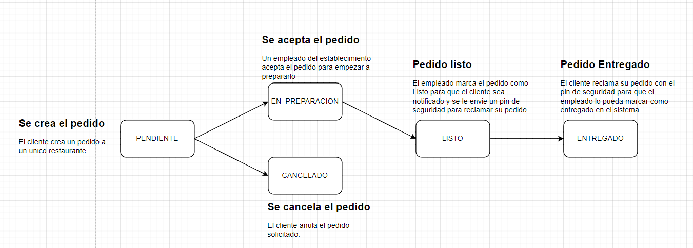

# Plaza de comidas

En este reto vas a diseñar el backend de un sistema que centraliza los pedidos de una plazoleta de comidas que tiene diferentes restaurantes, cada uno con un menú particular.

La plataforma busca que cualquier persona identificada como cliente en el sistema pueda hacer un pedido en cualquier restaurante de la plazoleta, buscando en los menús de cada uno. En el portal web el Cliente podrá ver la variedad de platos que ofrece cada uno de los diferentes establecimientos.

El usuario administrador de este sistema debe poder crear los restaurantes que tendrán cobertura, también podrá crearle una cuenta al propietario de cada restaurante para gestionar la información de su menú y poder realizar acciones como crear, modificar y eliminar platos de la carta y a su vez crear los usuarios para los empleados que van a atender los pedidos del establecimiento.

Cada pedido realizado por un cliente pasa por varias fases:

La primera fase es cuando se realiza un pedido a un restaurante, y este queda en el estado “PENDIENTE”, en esta fase el pedido se encolara en la lista de pedidos pendientes por el restaurante.

Una vez el cliente haya realizado el pedido de un mismo restaurante, se notificará a los empleados de ese restaurante para que puedan asignarse a esa orden y comenzar a preparar la lista de platos.

Mientras el pedido está en estado “PENDIENTE” pueden ocurrir 2 escenarios, el primero es que el pedido sea aceptado por un empleado del establecimiento y se cambie al estado “EN\_PREPARACION” y el segundo escenario es que el cliente puede cancelar el pedido solo si sigue en estado PENDIENTE.

Una vez finalice la elaboración del pedido, el empleado lo marcará con el estado “LISTO” y en ese momento se le enviará al cliente vía SMS un pin de seguridad para poder reclamar su pedido.

Una vez le entregue el pin de seguridad al empleado del establecimiento este podrá marcar el pedido como entregado para que el cliente disfrute su elección.

Un pedido es una lista de platos de un mismo restaurante, y un cliente solo puede hacer un pedido a la vez; es decir, que, si un cliente tiene un pedido en un estado “PENDIENTE”,”EN\_PREPARACION” o “LISTO” no podrá realizar otro pedido hasta que el pedido actual tenga el estado “ENTREGADO” o “CANCELADO”.

Cada cliente tiene la opción de poder ver la trazabilidad de los pedidos realizados con el propósito de ver cuanto tiempo paso el pedido en cada estado.

Los propietarios de cada restaurante tendrán disponible una funcionalidad para ver el tiempo de duración de cada uno de los pedidos para identificar cuales pedidos son mas demorados al promedio y ver que como optimizarlos.

**Funcionalidades no contempladas**:

* No se contempla un flujo asociado al pago, ya que se encuentra contratado con otro proveedor.  
* Esta aplicación no contempla el desarrollo de frontend y pretende reemplazar un backend actual que se encuentra construido con tecnologías obsoletas.

| Rol | Microservicio | Funcionalidades |
| ----- | ----- | ----- |
| Administrador |  | Crear restaurante Crear cuenta propietario |
| Propietario |  | Crear platos. Modificar el plato. Eliminar el plato. Crear cuenta empleado. Ver tiempos de pedidos |
| Empleado |  | Listar pedidos en estado “PENDIENTE”. Asignarse a pedido como Chef (cambiar estado a “EN\_PREPARACION”). Notificar que el pedido está listo. Entregar pedido. |
| Cliente |  | Listar los restaurantes. Listar platos por restaurante. Realizar pedido. Cancelar pedido. Ver trazabilidad |

**RECOMENDACIONES**:

* En la bd relacional recomendamos MySQL o PgSQL.  
* La bd no Relacional recomendamos mongoDB o dynamodb.  
* El api de Twilio lo pueden remplazar por SNS o la api de WSP.  
* Cada microservicio es un repositorio aparte.  
* Seguir la guia de GIT del classroom para el desarrollo del reto.  
* Cada microservicio lo pueden comenzar desde el arquetipo que les compartimos en el classroom.  
* Trabajar las HU 1 a la vez.  
* Para solucionar impedimentos pueden consultar:  
  * [Comunidad Talent Pool Chat.](https://chat.google.com/room/AAAAEX40UGg?cls=4)  
  * [Chapter Backend](https://chat.google.com/room/AAAA6h5PH5s?cls=4)  
  * [Grupo Workplace Talent Pool](https://pragma.workplace.com/groups/719284642073179)  
  * [Grupo Workplace Chapter Backend](https://pragma.workplace.com/groups/1274587552876064)  
  * Algun lider de talent pool.  
* Actualizar a diario el registro de tu avance [aca](https://docs.google.com/forms/d/e/1FAIpQLSc0pXbNZ499zM-pdAw0MMuzLSjmphCQ8qTN0m2SZOwqVaA4rA/alreadyresponded).  
* Cada Hu debe tener sus respectivas pruebas unitarias.  
* Cada Hu debe estar en una rama independiente.  
* Cada microservicio debe tener su respectiva documentación con OpenAPI.  
* Cada microservicio debe estar en arquitectura hexagonal.
